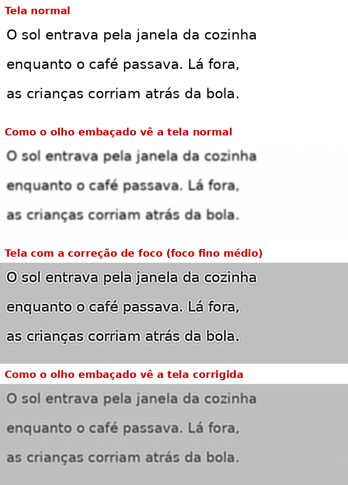

# Regulador de Foco (Android)

Um "óculos" para a tela do celular, para quem enxerga embaçado: sem óculos à mão, com a vista cansada ou antes de dormir. O teste mede o embaçado de cada olho, e o app **corrige o foco da imagem da tela inteira**, em qualquer app, no grau escolhido pela pessoa.

## Como a correção de foco funciona

O olho embaçado espalha cada ponto da tela num pequeno disco. O app calcula uma imagem "pré-corrigida": quando o olho a borra, o resultado fica mais perto do texto nítido. Isso é feito na placa de vídeo do celular, em 18 passadas (método de Landweber projetado), respeitando o preto e o branco da tela.

- **Foco geral** é o grau: o tamanho do embaçado que a correção compensa.
- **Foco fino** é a intensidade. A correção precisa de espaço além do preto e do branco, então ela troca contraste por nitidez: mais forte deixa o fundo mais cinza e as letras mais definidas para o olho embaçado.

A imagem acima é uma simulação feita com os mesmos shaders do app, com embaçado de 3 px. A nitidez percebida (correlação com o texto original, 1 = perfeita) sobe de **0,84 para 0,90**. O ganho é real, mas tem limite: corrigir só pela imagem, sem lente, não iguala os óculos, e custa contraste.

**Limite do Android:** nenhum app pode processar a tela ao vivo. Por isso, quando a tela para, o app tira uma foto dela, corrige e mostra a versão corrigida exatamente por cima. Os toques passam direto para o app embaixo. Ao tocar ou rolar, aparece a tela normal; cerca de meio segundo depois de parar, volta a corrigida. Telas protegidas (banco, senhas) e vídeos ficam sem correção. Precisa de **Android 13 ou mais novo**.

O app não substitui a consulta com oftalmologista nem os óculos.

## Os testes

Tudo na distância em que a pessoa segura o celular:

1. **A letra E girando**: primeiro o olho esquerdo (tapando o direito), depois o direito e por fim os dois juntos. Mede o embaçado de cada olho e dá o primeiro palpite do grau.
2. **Com ou sem correção?**: o mesmo texto de dois jeitos, 1 e 2. Se a pessoa enxergar melhor sem, a correção fica desligada.
3. **Foco geral**: "melhor o 1 ou o 2?" em 3 rodadas, cada vez mais finas, como as lentes do oftalmologista.
4. **Foco fino**: a intensidade, em 2 rodadas.
5. **Luz para antes de dormir**: a força do filtro âmbar.

A tela é uma só e os dois olhos veem a mesma imagem. Por isso o ajuste usa o resultado dos dois olhos juntos (recomendado), ou só o do esquerdo ou só o do direito. Se um olho enxerga bem pior que o outro, o app recomenda procurar um oftalmologista.

## Na tela principal

- **Foco geral** e **foco fino** em barras de 0 a 100, com um texto de exemplo mostrando a correção ao vivo.
- **Modos**:
  - **Sem óculos**: a correção de foco.
  - **Antes de dormir**: a correção de foco mais o filtro âmbar.
  - **Normal**: desliga tudo.
- **Botão rápido "Óculos de tela"** na barra de notificações: um toque liga o último modo, outro desliga.
- **Extra opcional**: também aumentar as letras do sistema. Começa desligado, porque o foco é o principal.

## Celular mais leve

Na tela principal, **Verificar o celular** abre uma checagem do que deixa o celular mais lento.

**Fazer direto no celular (com o Shizuku).** Um app comum não pode desativar outro nem mudar as animações do sistema. O [Shizuku](https://play.google.com/store/apps/details?id=moe.shizuku.privileged.api), gratuito, dá ao app a mesma permissão de quem liga o celular num computador pelo cabo, só que pela "Depuração sem fio" do próprio celular. Com ele conectado, os botões agem direto: desativam os apps de fábrica (`pm disable-user`) e põem as animações em 0,5× (`settings put global`). Tudo pode ser desfeito: "Reativar" religa o que o app desativou e "Voltar animações ao normal" volta a 1×. Os comandos vão como lista de argumentos, sem interpretador, e só aceitam nomes de app válidos.

Como ligar o Shizuku (uma vez; depois de reiniciar o celular, só o último passo):
1. Esteja num Wi-Fi.
2. Libere as Opções do desenvolvedor: Sobre o telefone → Informações do software → toque 7 vezes em "Número de compilação".
3. No Shizuku, toque em "Parear" e siga: Opções do desenvolvedor → "Depuração sem fio" → "Parear dispositivo com código"; digite o código na notificação do Shizuku.
4. No Shizuku, toque em "Iniciar". No Regulador, toque em "Conectar ao Shizuku".

Sem o Shizuku, cada botão abre a tela certa do Android para a pessoa tocar em "Desativar".

O que a checagem mostra:
- **Fluidez**: economia de energia ligada (ela deixa o processador mais lento), menos de 15% de espaço livre, animações em velocidade normal (vale 0,5×) e a "Suavidade de movimento" em 120 Hz.
- **Apps de fábrica dispensáveis**: uma lista fechada e conservadora, só com o que é seguro desativar (Bixby, Samsung Free, AR Zone, Samsung TV Plus, os instaladores do Facebook, OneDrive e outros). Fica de fora tudo o que o sistema usa.
- **Apps parados há 30 dias ou mais**, do maior para o menor, com o botão "Desinstalar" (o Android pede confirmação, porque apaga os dados do app). Precisa da permissão "Acesso aos dados de uso".

## Instalar no celular

1. Abra a página **Releases** do repositório no celular e baixe `app-debug.apk` da versão "Última versão".
2. Permita "instalar apps desconhecidos" para o navegador (só na primeira vez) e instale.
3. No app, toque em **Abrir Acessibilidade**, procure **Apps instalados → Regulador de Foco** e ligue. Se o Android disser que é uma "configuração restrita": abra **Informações do app**, toque nos 3 pontinhos (⋮) e em **Permitir configurações restritas**. Depois tente de novo.

Cada push na `main` gera um APK novo automaticamente.

## Como funciona por dentro

- `FocusPasses.kt`: os shaders da correção (AGSL), sem nada de Android: começo, 8 iterações de resíduo e atualização, e o fim, que devolve a cor.
- `FocusShader.kt`: encadeia as passadas na placa de vídeo e mostra a imagem corrigida (`CorrectedImageView`).
- `FocusLens.kt`: a lente sobre qualquer app: foto da tela quando ela para, correção e imagem por cima; some ao tocar.
- `FocusService.kt`: o serviço de acessibilidade que liga a lente e o filtro da noite.
- `VisionMath.kt`: o teste do "E" (0,4 a 12,6 mm, passos de 0,1 logMAR), o "1 ou 2" e as faixas de foco geral e fino. Testado em `VisionMathTest.kt`.
- `Cleanup.kt` e `CleanupActivity.kt`: o "Celular mais leve" (regras e comandos testados em `CleanupTest.kt`). `ShellAccess.kt`: a conexão com o Shizuku.
- `VisionTestActivity.kt`: os testes. `MainActivity.kt`: a tela principal. `RegulatorTileService.kt`: o botão rápido.
